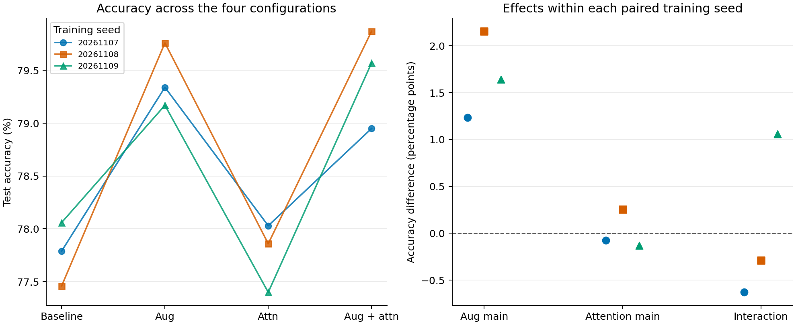

# 不同训练种子下的增强与注意力对照

3 个训练种子均使用同一训练/验证划分；每个种子内四组训练轮数相同。模型按验证准确率选择，同分取较早轮次。时间是 history.csv 中各轮训练与验证秒数之和，不含模型保存和最终测试。

| 种子 | 方案 | 测试准确率 | 验证最佳轮 | 最佳验证准确率 | 训练与验证（秒） |
|---:|---|---:|---:|---:|---:|
| 20261107 | 基线 | 77.79% | 8 | 78.16% | 23.3 |
| 20261107 | 仅增强 | 79.34% | 8 | 79.94% | 19.9 |
| 20261107 | 仅注意力 | 78.03% | 8 | 78.64% | 22.6 |
| 20261107 | 增强＋注意力 | 78.95% | 8 | 79.84% | 21.8 |
| 20261108 | 基线 | 77.46% | 8 | 78.04% | 20.3 |
| 20261108 | 仅增强 | 79.76% | 8 | 80.04% | 20.0 |
| 20261108 | 仅注意力 | 77.86% | 8 | 78.12% | 21.8 |
| 20261108 | 增强＋注意力 | 79.87% | 8 | 80.82% | 21.6 |
| 20261109 | 基线 | 78.06% | 8 | 78.04% | 20.3 |
| 20261109 | 仅增强 | 79.17% | 8 | 79.14% | 19.9 |
| 20261109 | 仅注意力 | 77.40% | 7 | 77.58% | 21.7 |
| 20261109 | 增强＋注意力 | 79.57% | 8 | 79.74% | 21.9 |

| 方案 | 测试准确率均值 ± 样本标准差（%） |
|---|---:|
| 基线 | 77.77 ± 0.30 |
| 仅增强 | 79.42 ± 0.30 |
| 仅注意力 | 77.76 ± 0.33 |
| 增强＋注意力 | 79.46 ± 0.47 |

比较单位为准确率百分点。增强主效应取“仅增强−基线”和“组合−仅注意力”之均值；注意力主效应同理。交互效应是（组合−仅增强）−（仅注意力−基线），描述加入增强后注意力增益的变化。

| 对照 | 20261107 | 20261108 | 20261109 | 均值 ± 样本标准差 | 正 / 零 / 负 |
|---|---:|---:|---:|---:|---:|
| 增强主效应 | +1.24 | +2.15 | +1.64 | +1.68 ± 0.46 | 3 / 0 / 0 |
| 注意力主效应 | -0.07 | +0.26 | -0.13 | +0.02 ± 0.21 | 1 / 0 / 2 |
| 交互效应 | -0.63 | -0.29 | +1.06 | +0.05 ± 0.89 | 1 / 0 / 2 |

- 增强主效应：所有种子均为正，范围 +1.24 至 +2.15 个百分点。
- 注意力主效应：各个种子的符号不完全一致，范围 -0.13 至 +0.26 个百分点。
- 交互效应：各个种子的符号不完全一致，范围 -0.63 至 +1.06 个百分点。

下表按相同测试图像配对。纠正指参考组判断错误而比较组判断正确，退化则相反，二者之差对应净新增的正确预测数。全部六组两两比较见 paired_switches.csv。

| 种子 | 基线 → 组合：纠正 | 退化 | 净增正确样本 |
|---:|---:|---:|---:|
| 20261107 | 775 | 659 | +116 |
| 20261108 | 856 | 615 | +241 |
| 20261109 | 782 | 631 | +151 |

这些均值与标准差描述同一官方测试集、同一数据划分上的 3 次训练结果。图中的点各代表一个实际训练种子，不能把重复评估当成额外的独立测试图像。
